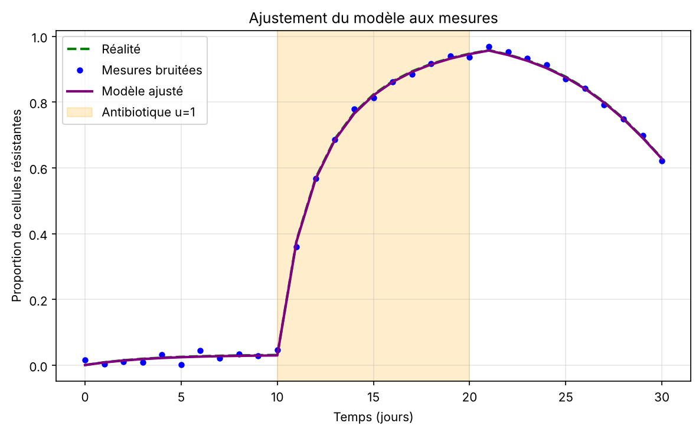
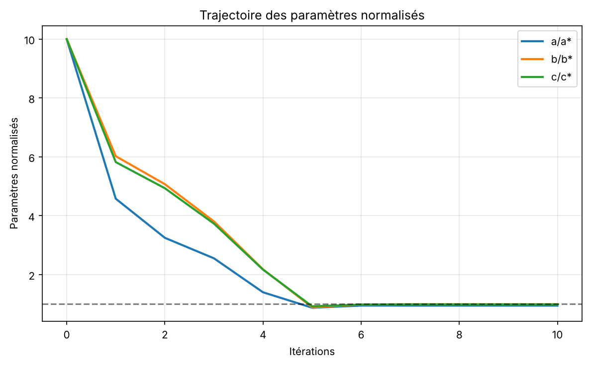
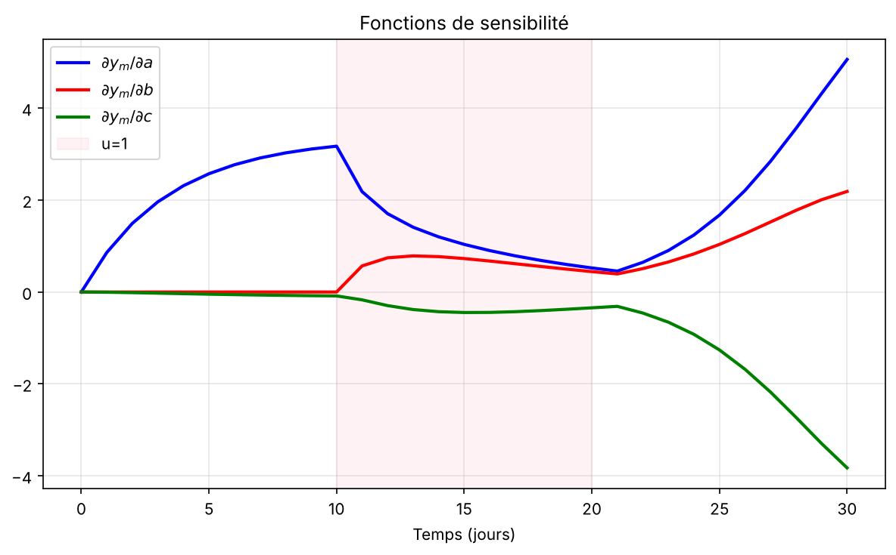

# Parameter identification of antibiotic resistance dynamics

Can we recover the parameters of a bacterial resistance model from noisy measurements, and how precisely? This project builds a two-compartment ODE model of antibiotic resistance, studies its identifiability, estimates its parameters with a **damped Gauss–Newton (Levenberg–Marquardt)** method, and quantifies their uncertainty with the **Fisher information matrix**.

Research project by **Shyrine Sallam** and **Adam Messaoudi**, course *Parametric Identification and Optimization* (UE 211), ENS Paris-Saclay, 2026, graded 18/20. Full report (in French): [`report/Rapport_antibioresistance.pdf`](report/Rapport_antibioresistance.pdf).

## Model

$S(t)$ and $R(t)$ are the susceptible and resistant bacterial populations, $u(t) \in \{0, 1\}$ indicates whether the antibiotic is present, and the measured output is the proportion of resistant cells $y = R/(S+R)$:

$$
\dot S = -(a + b\,u)\,S, \qquad \dot R = (a + b\,u)\,S - c\,R
$$

| Parameter | Meaning | True value |
|---|---|---|
| $a$ | spontaneous mutation rate S → R | $10^{-2}$ day⁻¹ |
| $b$ | additional mutation rate under antibiotic | $0.5$ day⁻¹ |
| $c$ | elimination rate of resistant cells (fitness cost) | $0.3$ day⁻¹ |

The true values are taken from orders of magnitude in the experimental literature cited in the report.

## Method

1. **Identifiability.** With $u = 0$, $b$ disappears from the model. With $u = 1$, only $a + b$ can be recovered. An **alternating protocol** (no antibiotic, then antibiotic on days 10–20, then none) makes all three parameters identifiable.
2. **Synthetic data.** The model is simulated on 30 days with that protocol, and Gaussian noise ($\sigma = 0.01$) is added to the 31 daily measurements, as with flow cytometry.
3. **Sensitivity functions.** The 2 state equations are extended with the 6 sensitivity equations $\partial S/\partial p$, $\partial R/\partial p$. The resulting 8-dimensional system is integrated in a single pass with the explicit Euler method, which gives the model output and its Jacobian together.
4. **Estimation.** Damped Gauss–Newton solves $(J^\top J + \mu I)\,\Delta p = -J^\top r$, adapting $\mu$ at each iteration and keeping the parameters positive.
5. **Uncertainty.** 95% confidence intervals come from $\mathrm{Cov}(\hat p) \approx \sigma^2 (J^\top J)^{-1}$.

## Results

Starting from an initial guess **10 times larger** than the true values, the algorithm converges in **16 iterations**.

| Parameter | True | Estimate | Relative error | 95% CI (Fisher) |
|---|---|---|---|---|
| $a$ | 0.0100 | 0.00947 | 5.3% | [0.00705, 0.01190] |
| $b$ | 0.500 | 0.4954 | 0.9% | [0.4816, 0.5093] |
| $c$ | 0.300 | 0.2971 | 1.0% | [0.2872, 0.3069] |

Every true value lies inside its confidence interval. $a$ is the least precisely determined parameter. The residuals stay within ±2σ with no visible structure, which is consistent with pure measurement noise.







## Files

```
code_final.py           model, sensitivities, Levenberg-Marquardt, confidence intervals, figures
donnees_simulees.csv    simulated measurements (31 days)
figures/                the 7 figures of the report
report/                 full report (French)
```

## Run it

```bash
pip install -r requirements.txt
python code_final.py
```

The script prints the estimates and confidence intervals, then writes the CSV and the 7 figures to the current directory.

## Note

As stated in the report, AI was used as an assistant for LaTeX formatting, figure generation and suggesting references.
